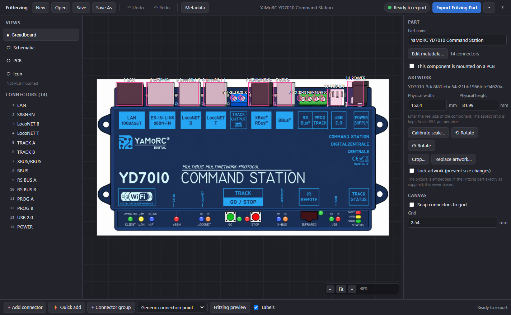
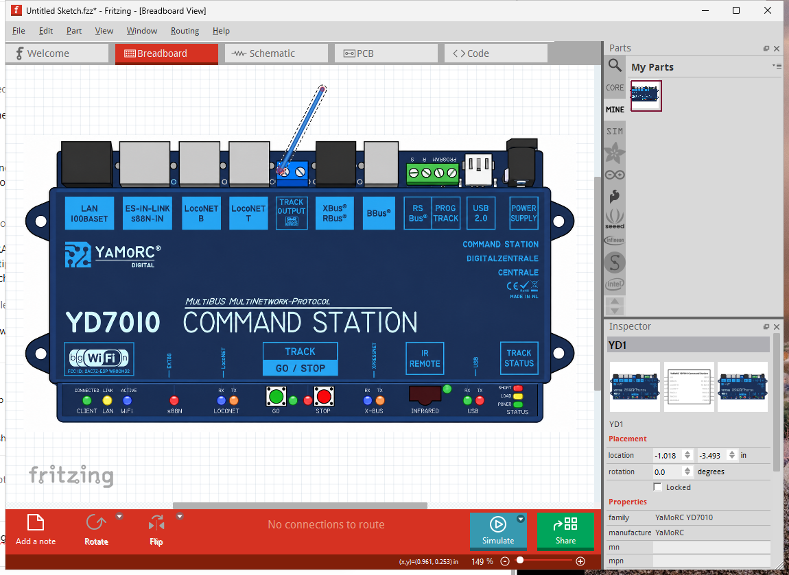
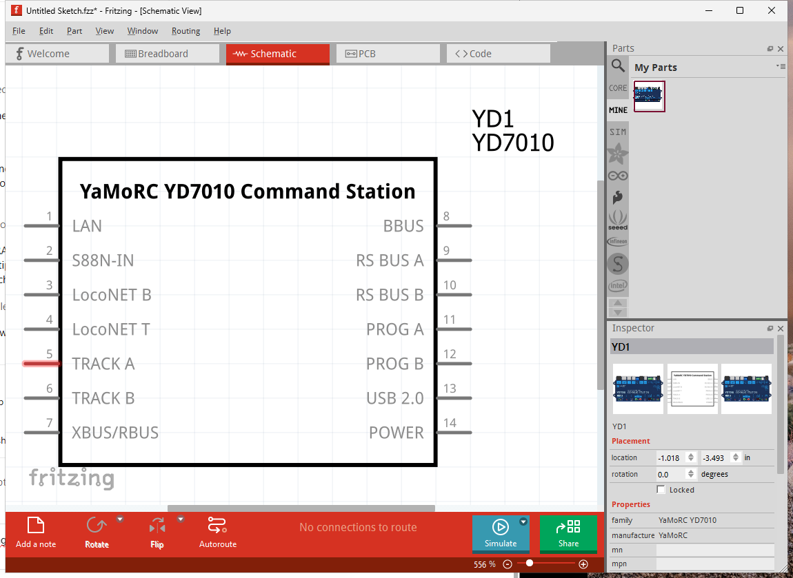

<p align="center"></p>

# Fritterzing

**Fritzing Parts Editor.** Drop in a picture of an electronic component, click where the wires attach, name the connections, and export a working Fritzing part.

Fritterzing hides Fritzing's part format completely. You work with pictures, sockets, pins and names; the application generates the `.fzp` definition, the breadboard, schematic, PCB and icon SVGs, every `connectorN` / `connectorNpin` / `connectorNterminal` id, the layer ids and the `.fzpz` package.

## The five-minute workflow

1. **Drop an image** (PNG, JPEG or SVG) of the module onto the window, or press *New* and choose one. A product photo is fine: the picture is embedded exactly as supplied and never traced.
2. **Enter its real width** in millimetres, or press *Calibrate scale…* and click two points a known distance apart (for example 5.08 mm between two screw terminals).
3. **Add connectors.** Press *Quick add* (or `Q`): every click on the board opens a small dialog for the name, type, description and socket type. *Add connector* (`A`) places markers without the dialog, naming them in the Inspector. Common names such as `GND`, `SDA`, `TX` autocomplete. *Connector group* places a whole row of pins between two clicks.
4. **Check the schematic**, generated automatically on Fritzing's 0.1 inch grid. Reorder pins or move them to another side in the panel on the right. Decide in *PCB* whether the part is PCB mounted; wiring-only devices stay off the PCB.
5. **Export Fritzing Part** when the indicator says *Ready to export*. Open the `.fzpz` in Fritzing (File › Open, or drag it onto the parts bin) and wire it up. *Fritzing preview* lets you try the wiring beforehand.

Problems are reported in plain language ("Track B has no connection point in Breadboard View") and most offer a one-click repair.

Every change is autosaved within half a second. If the app crashes or is closed without saving, the next start offers to recover the unsaved work; a successful save clears the autosave.

## Verified with Fritzing 1.0.8

The sample export in `files/` was opened in Fritzing 1.0.8 on Windows: it imports into the MINE bin, places on the breadboard at the right physical size, hovering a terminal shows its name and description, a wire dragged from the TRACK A screw snaps to it, and the generated schematic symbol shows that pin as connected.

| Editor | Fritzing breadboard view | Fritzing schematic view |
| --- | --- | --- |
|  |  |  |

## Opening existing parts

Open or drop a `.fzpz` to inspect, repair and re-export a part. Fritterzing recovers the connector positions from the SVGs, keeps the original graphics, lifts a picture back out of an SVG wrapper so it can be cropped and rotated, and shows a diagnostics summary. Dropping a bare `.fzp` together with its SVG files works too.

## Files

| Extension | What it is |
| --- | --- |
| `.fpe` | Fritterzing project: artwork, connectors, metadata and settings. Keep this to edit later. |
| `.fzpz` | The Fritzing part you export. Also importable. |

The *Export ▾* menu also writes the individual breadboard, schematic, PCB and icon SVGs, the `.fzp`, or an unpacked part folder as a zip.

## Building

Requires Node 20 or newer.

```bash
npm install
npm run dev        # Electron app with hot reload
npm run web        # Browser-only mode at http://localhost:5174 (file pickers and downloads)
npm test           # Pipeline tests (compile, validate, pack, import, project files)
npm run typecheck
npm run dist:win   # Windows installer and portable exe in release/
npm run dist       # Installer for the current platform (nsis, dmg, AppImage/deb)
npm run smoke -- "release/Fritterzing 0.1.0.exe"   # launch the packaged app and check it end to end
```

The smoke test drives the packaged executable over the Chrome DevTools Protocol: it checks the start screen and the Electron file bridge, imports `files/YD7010_YaMoRC.fzpz` through the app's own drop handler, verifies that every connector is placed and the part validates, round-trips the autosave, and saves screenshots to `smoke-out/`. It closes the app and exits non-zero on any failure.

## How the generated part is structured

| File in the `.fzpz` | Contents |
| --- | --- |
| `part.<id>.fzp` | Metadata, views and every connector with its breadboard, schematic and PCB mappings. |
| `svg.breadboard.<id>_breadboard.svg` | Your artwork embedded in a `breadboard` layer, with invisible `connectorNpin` / `connectorNterminal` targets. |
| `svg.schematic.<id>_schematic.svg` | Labelled rectangle on the 2.54 mm grid, pins with terminals at the outer ends, in the `schematic` layer. |
| `svg.pcb.<id>_pcb.svg` | `silkscreen` outline plus `copper0` / `copper1` pads (through-hole) or `copper1` only (SMD). Omitted for wiring-only parts, whose PCB view points at the breadboard layer, the same idiom Fritzing's own breadboard part uses. |
| `svg.icon.<id>_icon.svg` | 32 × 32 px parts-bin icon in the `icon` layer. |

`<id>` is a safe form of the part name plus a random suffix, so custom parts never collide.

## Layout of the source

- `src/core` – the model and the compiler: SVG generators (`svg/`), `fzp.ts`, `compile.ts`, `fzpz.ts`, `importFzp.ts` (with `svgGeom.ts` for measuring existing SVGs), `validate.ts`, `project.ts`, `templates.ts`, `presets.ts`. No UI dependencies; covered by `tests/`.
- `src/renderer` – the React editor: canvas, inspector, views, dialogs, store with undo history.
- `src/main`, `src/preload` – Electron shell: native file dialogs, autosave.

`files/YD7010_YaMoRC.fzpz` is a sample part used by the tests.

MIT licence.
